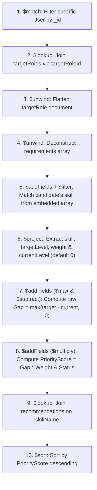

# Personalized Skill Gap Tracking & Recommendation System Using MongoDB
## Comprehensive Project Explanation, Architecture & Faculty Viva Defense Guide

> **Course**: Database Systems Lab (`BCSE302P`)  
> **Degree**: B. Tech in Computer Science and Engineering  
> **School**: School of Computer Science and Engineering (SCOPE), VIT  
> **Team Members**:
> - **Tharakesha M** (24BCE2538)
> - **Mathu Metha S** (24BCE2805)
> - **Charulatha Venkatraman** (24BCE0977)
> - **Jai Jagannayagam** (24BCE2563)

---

## 1. Executive Summary & Problem Statement

In today's fast-evolving technology landscape, students and professionals face significant ambiguity regarding their readiness for specific career pathways. Traditional career advice is often generic, and static resumes do not systematically reflect quantitative competency benchmarks.

The **Personalized Skill Gap Tracking and Recommendation System** is a full-stack, database-centric platform designed to:
1. Objectively quantify a candidate's current proficiencies against **22 standardized Computer Science career roles**.
2. Identify missing competencies and weak proficiencies using high-performance **MongoDB Aggregation Pipelines**.
3. Calculate an overall **Career Readiness Score (0–100%)** and prioritize gaps by business impact.
4. Provide **Curated Learning Roadmaps** (courses, documentation, time-to-bridge estimates) to eliminate identified gaps.
5. Track skill progression dynamically over time through timestamped milestone snapshots.

---

## 2. Why MongoDB? (Relational vs. Document Model Justification)

When faculty ask: *"Why did you choose MongoDB instead of MySQL, Oracle, or PostgreSQL?"*, your team should highlight these **4 architectural justifications**:

```
┌─────────────────────────────────┬────────────────────────────────────────────────────────┐
│ Relational Databases (SQL)      │ MongoDB (Document Store)                               │
├─────────────────────────────────┼────────────────────────────────────────────────────────┤
│ Rigid tabular schemas with      │ Dynamic schema: Different career roles have completely  │
│ fixed column counts.            │ non-uniform sets of skills, categories, and weights.   │
├─────────────────────────────────┼────────────────────────────────────────────────────────┤
│ Requires expensive multi-table  │ Embedded documents allow a user's skills array to live │
│ JOINs across 5+ normalization   │ directly inside their profile, retrieved in 1 atomic   │
│ tables (Users, Skills, Grades). │ disk read without complex table joins.                 │
├─────────────────────────────────┼────────────────────────────────────────────────────────┤
│ Complex multi-level grouping    │ Native Aggregation Framework ($lookup, $unwind,        │
│ requires stored procedures.     │ $filter, $max) processes entire math pipeline.         │
├─────────────────────────────────┼────────────────────────────────────────────────────────┤
│ Rigid schema migrations when    │ Effortlessly add new emerging tech (e.g. LangChain,    │
│ industry requirements evolve.   │ RAG, Vector Search) without altering schema tables.    │
└─────────────────────────────────┴────────────────────────────────────────────────────────┘
```

---

## 3. Database Architecture & Collections Design

The system runs on **MongoDB v7** inside a Docker container (`skilltracker-mongo`) on port `27017`. The database is named `skilltracker` and contains **5 distinct collections**:

```
                               ┌───────────────────────────┐
                               │       skills (Master)     │
                               │  (39 CS Competencies)     │
                               │  *Text Index on Name/Cat* │
                               └─────────────┬─────────────┘
                                             │
                       ┌─────────────────────┼─────────────────────┐
                       ▼                     ▼                     ▼
             ┌──────────────────┐  ┌──────────────────┐  ┌──────────────────┐
             │   targetRoles    │  │      users       │  │ recommendations  │
             │ (22 CS Roles +   │  │  (Profiles +     │  │ (Curated Courses │
             │  Benchmark Stds) │  │   Embedded Array)│  │  & Roadmaps)     │
             └─────────┬────────┘  └─────────┬────────┘  └──────────────────┘
                       │                     │
                       └───────────┬─────────┘
                                   │
                       ┌───────────▼──────────┐
                       │     progressLogs     │
                       │ (Chronological Audit │
                       │  Milestone Snapshots)│
                       └──────────────────────┘
```

### Collection Schemas & Design Patterns

#### 1. `users` (Hybrid Embedding Pattern)
Stores candidate information and an **embedded array** of acquired skills:
```json
{
  "_id": ObjectId("6acf8a79dd378122a8942df1"),
  "name": "Tharakesha M",
  "email": "24BCE2538@vitstudent.ac.in",
  "targetRoleId": ObjectId("6acf82d03158599022ca0321"),
  "skills": [
    { "name": "React", "level": 3 },
    { "name": "Python", "level": 4 },
    { "name": "MongoDB", "level": 3 }
  ],
  "createdAt": ISODate("2026-10-14T13:58:17.122Z"),
  "updatedAt": ISODate("2026-10-14T14:15:30.000Z")
}
```
* **Design Decision**: Skills are embedded directly inside the user document because a candidate's skills are always read together with their profile, guaranteeing atomic reads.

#### 2. `targetRoles` (Reference Pattern)
Defines industry requirements across 22 CS domains:
```json
{
  "_id": ObjectId("6acf82d03158599022ca0321"),
  "title": "Full Stack Developer",
  "domain": "Software Development",
  "description": "Designs and builds end-to-end web applications...",
  "requirements": [
    { "name": "React", "requiredLevel": 4, "category": "Frontend", "weight": 3 },
    { "name": "Node.js", "requiredLevel": 4, "category": "Backend", "weight": 3 },
    { "name": "MongoDB", "requiredLevel": 3, "category": "Database", "weight": 3 },
    { "name": "TypeScript", "requiredLevel": 3, "category": "Frontend", "weight": 2 },
    { "name": "REST API Design", "requiredLevel": 4, "category": "Backend", "weight": 2 },
    { "name": "Git", "requiredLevel": 3, "category": "Tools", "weight": 1 }
  ]
}
```
* **Design Decision**: Roles are referenced via `targetRoleId` in the user document (normalized reference) so benchmark criteria can be updated globally without updating thousands of individual user documents.

#### 3. `skills` (Master Taxonomy & Text Search Index)
Contains 39 standardized CS competencies:
```json
{
  "_id": ObjectId("..."),
  "name": "MongoDB",
  "category": "Database",
  "description": "NoSQL document database, aggregation pipelines, sharding, replica sets, and indexing."
}
```
* **Index**: `{ name: "text", category: "text", description: "text" }` enables instant keyword extraction from resumes.

#### 4. `recommendations` (Learning Roadmaps)
```json
{
  "_id": ObjectId("..."),
  "skillName": "MongoDB",
  "tier": "Beginner to Advanced",
  "title": "MongoDB Node.js Developer Path & Certification",
  "platform": "MongoDB University",
  "type": "Official Certification Path",
  "durationHours": 20,
  "url": "https://learn.mongodb.com"
}
```

#### 5. `progressLogs` (Audit Trail / Time-Series Snapshots)
```json
{
  "_id": ObjectId("..."),
  "userId": ObjectId("6acf8a79dd378122a8942df1"),
  "timestamp": ISODate("2026-10-14T14:20:00.000Z"),
  "action": "SKILL_LEVEL_UP",
  "skillName": "MongoDB",
  "oldLevel": 2,
  "newLevel": 4,
  "notes": "Achieved level 4 in MongoDB"
}
```

---

## 4. The MongoDB Aggregation Pipeline — Deep Dive

> [!IMPORTANT]
> **Faculty will ask**: *"Walk me through the stages of your aggregation pipeline in `skillGap.ts`."*  
> Memorize this sequence. The calculation is executed **100% inside MongoDB server memory**, not in Node.js!

Here is the exact step-by-step breakdown of the pipeline in `src/routes/skillGap.ts`:



### Stage Explanations:

1. **`$match: { _id: userId }`**:
   - Isolates the single active user document by their unique BSON `ObjectId`.
2. **`$lookup: { from: "targetRoles", localField: "targetRoleId", foreignField: "_id", as: "targetRole" }`**:
   - Performs a left outer join with the `targetRoles` collection to bring the benchmark requirements into the stream.
3. **`$unwind: "$targetRole"`**:
   - Deconstructs the joined single-element array into a flat document.
4. **`$unwind: "$targetRole.requirements"`**:
   - Deconstructs the `requirements` array into individual requirement documents. For a role with 6 skills, MongoDB now processes 6 separate pipeline documents.
5. **`$addFields` with `$filter`**:
   - Searches the user's embedded `skills` array for an entry where `skill.name == requirement.name`.
   - Uses `$first` to extract the matched skill object into `matchedSkill`.
6. **`$project` with `$ifNull`**:
   - Extracts `currentLevel`: if the candidate never recorded the skill, `$ifNull: ["$matchedSkill.level", 0]` defaults the proficiency to **0** (safely prevents null-pointer errors).
7. **`$addFields` with `$subtract` and `$max`**:
   - Calculates the **Raw Gap**:
     $$\text{Gap} = \max(\text{targetLevel} - \text{currentLevel}, 0)$$
   - If the candidate's level exceeds the benchmark, the gap is pinned to **0** (no negative gaps).
8. **`$addFields` with `$multiply` and `$cond`**:
   - Calculates the **Priority Score**:
     $$\text{Priority Score} = \text{Gap} \times \text{Weight}$$
   - Assigns human-readable status:
     - If `currentLevel == 0`: `"Missing Skill"`
     - Else if `gap > 0`: `"Needs Improvement"`
     - Else: `"Benchmark Satisfied"`
9. **`$lookup: { from: "recommendations", localField: "skill", foreignField: "skillName", as: "learningResources" }`**:
   - Joins matching courses, tutorials, and certifications directly for any missing or weak skill.
10. **`$sort: { priorityScore: -1, gap: -1 }`**:
    - Ranks the most critical skills to the top of the report.

---

## 5. Mathematical Formulations

### 1. Raw Competency Gap
$$\text{Gap}_i = \max(0, L_{\text{required}, i} - L_{\text{current}, i})$$

### 2. Weighted Priority Urgency Score
$$\text{Priority Score}_i = \text{Gap}_i \times W_i$$
*(Where $W_i \in [1, 3]$ is the skill importance weight: 3 = Core Essential, 2 = Secondary, 1 = Supporting).*

### 3. Career Readiness Score ($0 \le R \le 100\%$)
$$R = \left( \frac{\sum_{i=1}^{N} \min(L_{\text{current}, i}, L_{\text{required}, i}) \times W_i}{\sum_{i=1}^{N} L_{\text{required}, i} \times W_i} \right) \times 100\%$$
- **Formula Insight**: Candidates earn weighted points up to the benchmark requirement. Points are capped at $L_{\text{required}}$ so over-qualifying in one skill cannot artificially mask gaps in critical skills.

### 4. Multi-Role Fit (Alternative Pathways)
The system calculates the Readiness Score $R_k$ across all 21 remaining roles in `targetRoles`, sorting by descending readiness to highlight alternative career pathways.

---

## 6. Standout Special Features

1. **Smart Resume / Bio Skill Extractor**:
   - Candidates can paste unstructured resume paragraphs or GitHub bios.
   - A regular expression and token scanner matches keywords against the MongoDB `skills` master taxonomy and populates their profile instantly.
2. **Interactive "What-If" Skill Simulator**:
   - In-memory recalculation slider (`POST /api/skill-gap/simulate`).
   - Allows students to simulate: *"If I improve Docker to Level 4, how does my DevOps readiness change?"* without modifying database records.
3. **Curated Learning Roadmaps**:
   - Mapped courses with durations (hours), platforms (MongoDB University, Coursera, Udemy), and direct external links.
4. **Historical Progress Logging (Objective 5)**:
   - When a candidate clicks **"Level Up"**, MongoDB updates the user document and inserts a timestamped snapshot into `progressLogs`.
5. **Printable Audit Report**:
   - A styled report formatted for printing or PDF export with Candidate Name, Register Number, Competency Gap Matrix, and Recommended Roadmaps.

---

## 7. Technology Stack & Tools Used

| Layer | Technology | Justification |
| :--- | :--- | :--- |
| **Database** | **MongoDB v7** | Document model, Aggregation Pipeline, Text Indexing, BSON formatting. |
| **Containerization** | **Docker Desktop** | Isolated `skilltracker-mongo` container, persistent data volume. |
| **Backend Runtime** | **Node.js + TypeScript** | Asynchronous non-blocking I/O, strict typing for models and requests. |
| **Web Framework** | **Express.js (v5)** | Modular REST routing (`/api/users`, `/api/roles`, `/api/skill-gap`, `/api/skills`, `/api/progress`). |
| **Native Client** | **MongoDB Node Driver** (`mongodb`) | Official native driver for connection pooling and aggregation. |
| **Frontend UI** | **HTML5 + Tailwind CSS** | Clean dark-mode interface, responsive grid, zero heavy build steps. |
| **Data Visualization** | **Chart.js** | Interactive side-by-side bar chart showing Current Level vs. Benchmark. |

---

## 8. Faculty Viva Defense: Top 10 Questions & Model Answers

### Q1: Why did you compute the skill gaps using a MongoDB Aggregation Pipeline rather than in JavaScript/Node.js?
> **Answer**:  
> *"Computing the gap inside MongoDB's Aggregation Framework leverages database-level query optimization, avoids transferring raw documents over the network, and ensures that the calculation is performed on the database server in C++. This eliminates memory overhead in Node.js and provides a single, scalable source of truth for the gap logic."*

### Q2: What is the difference between embedded documents and references in your design?
> **Answer**:  
> *"We used a hybrid approach. The candidate's `skills` array is an **embedded document** inside `users` because skills are tightly coupled with the profile and always retrieved together, enabling single-seek atomic reads. However, `targetRoles` are **referenced** by `targetRoleId` because job requirements are shared benchmarks. Referencing avoids data duplication across thousands of candidates and allows global updates to benchmark criteria."*

### Q3: How do you handle cases where a student does not have a required skill in their profile?
> **Answer**:  
> *"In our aggregation pipeline, we use `$addFields` with `$filter` to find the skill. If no match is found, `$ifNull: ["$matchedSkill.level", 0]` safely defaults `currentLevel` to 0. The `$subtract` and `$max` operators then calculate a full gap equal to the target level, and the condition `$cond` marks the status as `'Missing Skill'`."*

### Q4: Why is the priority score calculated as Gap multiplied by Weight, instead of just using the raw gap?
> **Answer**:  
> *"In real industry roles, not all competencies carry equal weight. For example, for a Backend Engineer, missing MongoDB or Node.js (Weight 3) is far more critical than missing Git (Weight 1). The priority score ($\text{Gap} \times \text{Weight}$) ranks high-impact deficiencies first so students focus their limited study time on the most critical skills."*

### Q5: What indexes exist in your database and why?
> **Answer**:  
> *"We created:  
> 1. Default `_id` unique BSON indexes on all collections.  
> 2. A **Compound Text Index** on `{ name: "text", category: "text", description: "text" }` in the `skills` collection to power the Smart Resume Skill Extractor.  
> 3. A single field index on `{ skillName: 1 }` in `recommendations` to optimize `$lookup` joins."*

### Q6: What does the `$unwind` operator do in your pipeline?
> **Answer**:  
> *"The `$unwind` operator deconstructs an array field from the input documents to output a document for each element. In our pipeline, `$unwind: "$targetRole.requirements"` splits the array of required skills so that each competency can be evaluated, subtracted, and multiplied independently as an individual document."*

### Q7: How does your Career Readiness percentage formula prevent candidates from gaming the score?
> **Answer**:  
> *"In our readiness formula, earned points are capped at $\min(\text{currentLevel}, \text{requiredLevel})$. This means that having Level 5 in HTML cannot compensate for Level 0 in MongoDB for a Backend role. A candidate can only earn points up to the role's required benchmark."*

### Q8: How does the system support historical tracking (Objective 5)?
> **Answer**:  
> *"Whenever a student improves a skill or clicks 'Level Up', the backend executes two operations: it updates the user document using `updateOne` with `$set`, and it inserts a timestamped snapshot into `progressLogs` recording the date, old level, new level, and updated score. This allows rendering a progress timeline over time."*

### Q9: How is MongoDB deployed and accessed?
> **Answer**:  
> *"MongoDB v7 is containerized via Docker Desktop using the container name `skilltracker-mongo`. It is bound to port `27017` with volume persistence. The backend connects via the standard URI `mongodb://localhost:27017/skilltracker` using the official MongoDB native driver connection pool."*

### Q10: How can this system scale in a production enterprise environment?
> **Answer**:  
> *"MongoDB supports horizontal scalability via **sharding**. The `users` collection can be sharded using a hashed shard key on `_id` or `email`, distributing user profiles across multiple cluster shards. Read scalability can be further enhanced using **Replica Sets** with read preferences directing reporting queries to secondary nodes."*

---

## 9. Verification & Live Demo Checklist

- [x] Docker container running: `docker start skilltracker-mongo`
- [x] Backend running on port 4000: `npm start`
- [x] Dashboard accessible: `http://localhost:4000`
- [x] 22 CS Roles available in dropdown
- [x] Profile creation working with custom skills
- [x] Interactive Chart.js rendering current vs. target levels
- [x] Multi-Role Fit displaying alternative careers
- [x] Resume Extractor parsing skills from raw text
- [x] "What-If" simulator dynamically updating readiness score
- [x] Printable audit report ready for physical print or PDF export
